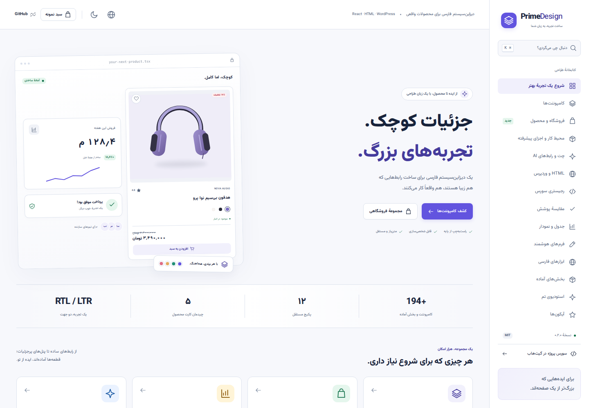

# PrimeDesign · پرایم دیزاین

یک دیزاین‌سیستم مستقل و فارسی برای ساخت فروشگاه، داشبورد و محصولات دیجیتال با **React، Next.js، HTML و WordPress**؛ شامل CSS مستقل، تم چندبرندی، ابزارهای فارسی، فرم، جدول و مجموعهٔ فروشگاهی.




[مشاهدهٔ تصویر مجموعهٔ فروشگاهی](docs/images/commerce.png) · [تصویر نسخهٔ HTML و وردپرس](docs/images/universal.png)

## اجرا

به Node.js 22 یا بالاتر نیاز دارید؛ `.nvmrc` نسخهٔ توسعه را مشخص می‌کند.

```bash
npm ci
npm run build
npm run dev
```

مستندات تعاملی در آدرس نمایش‌داده‌شده توسط Vite باز می‌شوند. برای پیش‌نمایش خروجی تولیدی:

```bash
npm run preview -w @primedesign/docs -- --host 0.0.0.0
```

## پکیج‌ها

| پکیج                    | مسئولیت                                                                     |
| ----------------------- | --------------------------------------------------------------------------- |
| `@primedesign/tokens`   | توکن‌های معنایی، طیف برند، ساخت تم و محاسبهٔ کنتراست                        |
| `@primedesign/css`      | استایل مستقل، Cascade Layers، فونت وزیرمتن و خروجی بدون فونت                |
| `@primedesign/persian`  | تاریخ شمسی، ارقام، پول، جست‌وجوی فارسی و اعتبارسنجی‌های ساختاری             |
| `@primedesign/icons`    | مجموعهٔ SVG با تایپ و نام دسترس‌پذیر                                        |
| `@primedesign/react`    | کنترل‌ها، انتخاب‌ها، تقویم، پنجره‌ها، اعلان، ناوبری و آپلود                 |
| `@primedesign/forms`    | فرم تایپ‌شده، SchemaForm، مراحل، آرایهٔ فیلدها، خطا و پیش‌نویس              |
| `@primedesign/data`     | جدول پیشرفته، حالت سرور، اسکرول مجازی و نمودارهای دارای معادل جدولی         |
| `@primedesign/commerce` | کارت‌ها و رفتار سبد، علاقه‌مندی، مقایسه و سفارش                             |
| `@primedesign/blocks`   | پوستهٔ پنل، تیکت، گفتگو، اعلان، پلن، ورود و فایل                            |
| `@primedesign/ai`       | چت، ورودی پیام، منابع، ابزارها، وظیفه‌ها و transport استریم                 |
| `@primedesign/elements` | Web Components و خروجی مستقل مرورگر، بدون نیاز به نصب React توسط مصرف‌کننده |
| `@primedesign/cli`      | راه‌اندازی، نصب سورس قابل ویرایش، بررسی اختلاف و ساخت تم                    |

## خروجی آمادهٔ HTML و وردپرس

- [دانلود نسخهٔ مرورگر ۰.۲.۰](downloads/primedesign-browser-0.2.0.zip): فایل HTML، اسکریپت مستقل، استایل و فونت.
- [دانلود افزونهٔ وردپرس ۰.۲.۰](downloads/primedesign-wordpress-0.2.0.zip): شورت‌کد، بلوک Gutenberg و اتصال کارت محصول به WooCommerce.
- [راهنمای همهٔ فرانت‌اندها و نصب افزونه](docs/UNIVERSAL.md). مصرف‌کنندهٔ HTML به نصب React نیاز ندارد؛ runtime داخلی در بسته قرار دارد.

```html
<script src="./primedesign-elements.js"></script>
<pd-provider locale="fa-IR" theme="light">
  <pd-button variant="outline">شروع کن</pd-button>
</pd-provider>
```

## مجموعهٔ فروشگاهی

- `ProductCard` با پنج چیدمان `default`, `compact`, `horizontal`, `minimal`, `featured`.
- تصویر و fallback، قیمت قبلی و فعلی، تخفیف، موجودی کم، ناموجود، امتیاز، رنگ و variant.
- رویدادهای افزودن به سبد، علاقه‌مندی، مقایسه و مشاهدهٔ سریع؛ حالت انتظار و خطای درخواست.
- `ProductGrid`, `ProductCardSkeleton`, `ProductGallery`, `QuickView`.
- `CategoryCard`, `PromoCard`, `BrandCard`, `ReviewCard`, `SellerCard`, `CouponCard`, `BundleCard`, `ProductDetail`.
- `CartProvider`, `CartLineItem`, `MiniCart`, `CartSummary`, `CouponInput`, `FreeShippingProgress`.
- `AddressCard`, `ShippingMethodPicker`, `CheckoutStepper`, `OrderCard`, `OrderTracking`, `CompareTable`.

نمونهٔ فروشگاه داخل مستندات، سبد مشترک در حافظهٔ مرورگر دارد. سفارش، پرداخت، احراز هویت و آپلود به سرویس خارجی وصل نیستند؛ adapter و callbackها را در برنامهٔ خودتان متصل کنید. قیمت، موجودی، تخفیف، مالیات و مجوزهای نهایی باید روی سرور دوباره محاسبه و بررسی شوند.

## استفاده در پروژهٔ دیگر

پکیج‌ها هنوز در npm عمومی منتشر نشده‌اند. بسته‌های محلی تمام وابستگی‌های داخلی را با هم نصب کنید:

```bash
# در این ریپو
npm run pack

# در برنامهٔ مصرف‌کننده
npm install /absolute/path/to/primedesign/artifacts/*.tgz
```

```tsx
import '@primedesign/css';
import { PrimeProvider, ToastProvider, Button } from '@primedesign/react';
import { CartProvider, ProductCard, useCart } from '@primedesign/commerce';

function Store({ product }) {
  const cart = useCart();
  return (
    <ProductCard
      product={product}
      onAddToCart={(p, quantity, variant) => cart.add(p, quantity, variant)}
    />
  );
}

export function App({ product }) {
  return (
    <PrimeProvider locale="fa-IR" brand="#6254df" defaultTheme="system">
      <ToastProvider>
        <CartProvider>
          <Store product={product} />
        </CartProvider>
      </ToastProvider>
    </PrimeProvider>
  );
}
```

برای Next.js، CSS را یک بار در `app/layout.tsx` وارد کنید و Providerها را در فایل `app/providers.tsx` با دستور `"use client"` قرار دهید. خروجی پکیج‌های تعاملی دستور کلاینت را حفظ می‌کند؛ `tokens` و `persian` مستقل از React و مناسب استفاده در سرور هستند.

## شخصی‌سازی

```tsx
<PrimeProvider
  locale="fa-IR"
  dir="rtl"
  brand="#177864"
  density="compact"
  radius={12}
  fontFamily='"Yekan Bakh", Vazirmatn, sans-serif'
>
  {children}
</PrimeProvider>
```

برای فونت دارای مجوز خودتان از `@primedesign/css/nofont.css` استفاده کنید و `@font-face` را در برنامهٔ خود تعریف کنید. وزیرمتن همراه پکیج است و فایل مجوز OFL آن هم توزیع می‌شود. یکان‌بخ همراه این ریپو نیست.

CSS کامل در لایه‌های `primedesign.*` قرار دارد؛ CSS بدون لایهٔ برنامهٔ شما اولویت بالاتری دارد. فایل‌های جداگانهٔ `tokens.css`, `base.css`, `components.css`, `commerce.css` هم ارائه می‌شوند. برای HTML تعاملی از `@primedesign/elements` و تگ‌های `pd-*` استفاده کنید. CSS به‌تنهایی فقط ظاهر را ارائه می‌کند. فایل‌های `advanced.css` و `ai.css` هم جداگانه موجودند.

## سورس قابل ویرایش و اجزای پیشرفته

```bash
primedesign add button product-card --source
primedesign search chat
primedesign diff product-card
primedesign doctor
```

۱۸۸ ورودی سورس از پیاده‌سازی‌های همین پروژه تولید می‌شود. نصب سورس شامل ماژول اصلی و وابستگی‌های محلی آن است؛ فایل‌های دست‌خورده بدون `--force` جایگزین نمی‌شوند. [راهنمای رجیستری](docs/SOURCE-REGISTRY.md).

پنل قابل تغییر اندازه، Sidebar، ContextMenu، Menubar، NavigationMenu، ToggleGroup، پرسش‌نامه، کدبلاک، Kanban، اعضای تیم، تنظیمات و اجزای AI به مجموعه اضافه شده‌اند. صفحهٔ «مقایسهٔ پوشش» در مستندات معادل‌ها و محدودیت‌ها نسبت به shadcn را نشان می‌دهد؛ یکسانی API یا برتری کامل اکوسیستم ادعا نمی‌شود.

## کیفیت

```bash
npm run check          # build + TypeScript + unit tests + package contents
npm run test:e2e       # Chromium desktop/mobile + axe accessibility checks
npm run format:check
```

قبل از اولین اجرای تست مرورگر: `npx playwright install chromium`.

تست‌ها محدودیت تاریخ در تایپ و میان‌بر، حفظ انتخاب جدول بین صفحات، کنترل موجودی سبد، خطای درخواست، اعتبارسنجی فرم، لغو و ادامهٔ آپلود تکه‌ای، مرز خروجی CLI و کنتراست توکن‌های پیش‌فرض را پوشش می‌دهند. این تست‌ها جای ارزیابی نهایی دسترس‌پذیری محصول شما با محتوای واقعی و فناوری‌های کمکی را نمی‌گیرند.

## مستندات توسعه

- [راهنمای HTML، وردپرس و فریم‌ورک‌های دیگر](docs/UNIVERSAL.md)
- [نصب سورس و رجیستری](docs/SOURCE-REGISTRY.md)
- [معماری](docs/ARCHITECTURE.md)
- [راهنمای اتصال به Next.js و Django](docs/INTEGRATION.md)
- [پروژهٔ نمونهٔ Next.js با نصب بسته‌های واقعی](examples/next-app/README.md)
- [قراردادها و محدودیت‌ها](docs/CONTRACTS.md)
- [مشارکت](CONTRIBUTING.md)
- [انتشار نسخه](docs/RELEASING.md)

کد با مجوز MIT منتشر شده است. تصویرهای SVG محصولات، طراحی‌های اصلی همین پروژه و صرفاً برای نمایش کامپوننت‌ها هستند؛ برندها و داده‌های فروشگاه نمونه‌اند.
